# 🚗 Sistema de Control y Gestión de Estacionamiento - Neology

> **Prueba Técnica Full Stack Developer**  
> Solución completa desarrollada con **Spring Boot 3** en el Backend y **Angular** con **Angular Material** en el Frontend.

---

## 📋 Tabla de Contenidos
1. [Descripción General](#-descripción-general)
2. [Arquitectura y Tecnologías](#-arquitectura-y-tecnologías)
3. [Nota sobre el Uso de IA en el Frontend](#-nota-sobre-el-uso-de-ia-en-el-frontend)
4. [Reglas de Negocio Implementadas](#-reglas-de-negocio-implementadas)
5. [Estructura del Proyecto](#-estructura-del-proyecto)
6. [Instrucciones para Levantar el Backend (Spring Boot)](#-instrucciones-para-levantar-el-backend-spring-boot)
7. [Instrucciones para Levantar el Frontend (Angular)](#-instrucciones-para-levantar-el-frontend-angular)
8. [Base de Datos Precargada](#-base-de-datos-precargada)
9. [Catálogo de Endpoints de la API](#-catálogo-de-endpoints-de-la-api)
10. [Ejecución de Pruebas Unitarias](#-ejecución-de-pruebas-unitarias)
11. [Características Adicionales y UX](#-características-adicionales-y-ux)
12. [📸 Galería de Imágenes](#-galería-de-imágenes)

---

## 🎯 Descripción General

El sistema permite gestionar de manera integral el acceso de vehículos a un estacionamiento corporativo/urbano, controlando:
- **Altas y catálogo de vehículos** clasificados por tipo (Oficial, Residente y No Residente/Visitante).
- **Control de estancias en tiempo real**: Registro de entradas, salidas y estancias activas.
- **Cálculo y cobro de tarifas automatizado** según la categoría del vehículo.
- **Cierre y reinicio de ciclo mensual** con reseteo de minutos y estancias finalizadas.
- **Informe de pagos de residentes** con cálculo de importes acumulados y exportación a PDF.

---

## 🛠️ Arquitectura y Tecnologías

### Backend (Spring Boot)
- **Lenguaje:** Java 17+
- **Framework:** Spring Boot 3.2.5
- **Persistencia:** Spring Data JPA + Hibernate
- **Base de Datos:** H2 Database (In-Memory)
- **Documentación API:** SpringDoc OpenAPI 2.5.0 (Swagger UI)
- **Validaciones:** Hibernate Validator / Jakarta Validation
- **Utilidades:** Lombok
- **Patrones de Diseño:**
  - **Strategy Pattern:** Implementado en `TarifaStrategy`, `TarifaContext`, `TarifaOficialStrategy`, `TarifaResidenteStrategy`, `TarifaNoResidenteStrategy` para permitir la incorporación limpia y desacoplada de nuevos tipos de vehículos.
  - **DTO Pattern:** Desacoplamiento entre entidades de persistencia y contratos de API.
  - **Global Exception Handler:** Control unificado de respuestas de error RFC 7807 (`@ControllerAdvice`).

### Frontend (Angular)
- **Framework:** Angular 21
- **Componentes UI:** Angular Material (@angular/material, @angular/cdk)
- **Estilos:** CSS moderno con tokens de diseño y diseño adaptativo (Responsive)
- **Reportes:** jsPDF + jsPDF-AutoTable para generación de reportes PDF
- **Módulos / Vistas:**
  - Dashboard de ocupación e indicadores clave
  - Operaciones (Entrada, Salida con ticket/cobro, Alta de vehículos, Cierre de mes)
  - Directorio de vehículos con búsqueda por placa, ordenamiento y paginación
  - Vista de detalle individual con historial de estancias y pagos acumulados
  - Reporte de residentes con desglose de montos y descarga en PDF

---

## 🤖 Nota sobre el Uso de IA en el Frontend

> [!NOTE]
> **Transparencia en el Desarrollo:**  
> En la parte del **Frontend**, se utilizó **Inteligencia Artificial (IA)** como herramienta de soporte estético para:
> - **Rellenar con diseño espacios en blanco** y enriquecer la composición visual de las interfaces para brindar un aspecto moderno y profesional.
> - **Ajustar y afinar elementos responsivos** en pantallas de diversos tamaños (dispositivos móviles y tablets).
>
> Cabe destacar que el uso de IA se implementó **únicamente en la capa visual y de adaptabilidad responsiva del Frontend**. Toda la lógica de negocio, arquitectura por capas, patrones de diseño (Strategy), endpoints REST, persistencia y suite de pruebas unitarias del Backend fueron estructurados bajo rigurosas buenas prácticas de desarrollo de software.

---

## ⚖️ Reglas de Negocio Implementadas

| Tipo de Vehículo | Tarifa por Minuto | Momento de Pago | Comportamiento |
| :--- | :--- | :--- | :--- |
| **Oficial** | **$0.00** / min | Exento | Entra y sale sin costo. Guarda historial de estancias. |
| **Residente** | **$0.05** / min | Fin de mes / acumulado | Al salir acumula los minutos de estancia en su cuenta. Paga en el corte mensual. |
| **No Residente** | **$0.50** / min | Al salir (en ventanilla) | Al registrar la salida se calcula el importe exacto con base en los minutos transcurridos. |

- **Cierre de Mes (`POST /neo/mes/iniciar`):**
  - Resetea a 0 los minutos acumulados de todos los residentes.
  - Elimina únicamente las estancias finalizadas (conservando las estancias actualmente activas en el estacionamiento).
- **Diseño extensible:** Para agregar un nuevo tipo (ej. `MOTOCICLETA` o `PROVEEDOR`), basta con implementar la interfaz `TarifaStrategy` e inyectarla en el contexto.

---

## 📁 Estructura del Proyecto

```text
Full-Stack-Prueba-tecnica-Neology/
├── Backend/
│   └── pruebatecnica/
│       ├── pom.xml
│       ├── mvnw / mvnw.cmd
│       └── src/
│           ├── main/java/.../
│           │   ├── config/          # Swagger OpenAPI y CORS
│           │   ├── controller/      # Endpoints REST (Vehiculos, Estancias, Residentes, Mes)
│           │   ├── data/            # DataLoader para precarga de datos H2
│           │   ├── dto/             # Objetos de transferencia de datos Request/Response
│           │   ├── exception/       # Manejador global de excepciones
│           │   ├── model/           # Entidades JPA (Vehiculo, Estancia, Residente, TipoVehiculo)
│           │   ├── repository/      # Interfaces Spring Data JPA
│           │   ├── service/         # Interfaces e implementaciones de lógica de negocio
│           │   └── strategy/        # Patrón Strategy para cálculo de tarifas
│           └── test/java/.../       # Tests unitarios y de integración (18 tests)
│
├── Frontend/
│   └── Parking-access/
│       ├── package.json
│       ├── angular.json
│       └── src/app/
│           ├── components/          # Modales: Ticket de entrada, Resultado de salida, etc.
│           ├── models/              # Modelos TypeScript
│           ├── pages/
│           │   ├── dashboard/       # Métricas de ocupación y accesos rápidos
│           │   ├── operations/      # Registros de entrada, salida, alta y cierre de mes
│           │   ├── vehicles/        # Listado con filtros, orden y paginación
│           │   ├── vehicle-detail/  # Detalle de vehículo, historial y minutos
│           │   └── reports/         # Informe mensual de pagos con exportación PDF
│           └── services/            # Clientes HTTP (ParkingApiService) y PDF (ParkingPdfService)
├── Screenshots/                     # Capturas de pantalla de la aplicación y flujos
└── README.md
```

---

## 🚀 Instrucciones para Levantar el Backend (Spring Boot)

### Requisitos Previos
- **Java Development Kit (JDK):** Versión 17 o superior instalada y configurada en el `PATH`.
- **Maven:** No es obligatorio tenerlo instalado globalmente ya que el repositorio incluye los wrappers `mvnw` y `mvnw.cmd`.

### Pasos de Ejecución

1. Abrir una terminal y navegar a la carpeta del backend:
   ```bash
   cd Backend/pruebatecnica
   ```

2. Ejecutar la aplicación con Maven Wrapper:
   - **En Windows:**
     ```powershell
     .\mvnw.cmd spring-boot:run
     ```
   - **En Linux / macOS:**
     ```bash
     ./mvnw spring-boot:run
     ```

3. El backend iniciará en el puerto **`8080`**.

### Accesos Disponibles
- **URL Base de la API:** `http://localhost:8080/neo`
- **Documentación Swagger UI (OpenAPI):**  
  👉 [http://localhost:8080/swagger-ui/index.html](http://localhost:8080/swagger-ui/index.html)
- **Consola de Base de Datos H2:**  
  👉 [http://localhost:8080/h2-console](http://localhost:8080/h2-console)  
  - **JDBC URL:** `jdbc:h2:mem:neology_db`
  - **User Name:** `SA`
  - **Password:** *(dejar vacío)*

---

## 💻 Instrucciones para Levantar el Frontend (Angular)

### Requisitos Previos
- **Node.js:** Versión 18.x, 20.x o superior.
- **npm:** Administrador de paquetes incluido con Node.js.

### Pasos de Ejecución

1. Abrir una terminal y navegar a la carpeta del frontend:
   ```bash
   cd Frontend/Parking-access
   ```

2. Instalar las dependencias del proyecto:
   ```bash
   npm install
   ```

3. Iniciar el servidor de desarrollo:
   ```bash
   npm start
   # o bien: npx ng serve
   ```

4. Abrir el navegador en:  
   👉 [http://localhost:4200](http://localhost:4200)

---

## 🗄️ Base de Datos Precargada

Al iniciar la aplicación, el componente [`DataLoader.java`](file:///c:/Users/flore/OneDrive/Documentos/Prueba%20tecnica/Full-Stack-Prueba-tecnica-Neology/Backend/pruebatecnica/src/main/java/com/gustavo/prueba/tecnica/neology/pruebatecnica/data/DataLoader.java) inicializa automáticamente en memoria registros para facilitar pruebas inmediatas:

- **Vehículos Oficiales:**
  - `OF-1001` (Vehículo Oficial Patrulla Norte)
  - `OF-1002` (Vehículo Oficial Inspección)
- **Vehículos Residentes:**
  - `RES-2001` (Residente Juan Pérez - con minutos y estancias previas)
  - `RES-2002` (Residente María González - con minutos acumulados)
  - `RES-2003` (Residente Carlos Ruiz)
- **Vehículos No Residentes / Visitantes:**
  - `VIS-3001`, `VIS-3002`, `VIS-3003`
- **Estancias Activas de Prueba:**
  - `RES-2001` y `VIS-3001` con ingreso registrado para probar la salida inmediata.

---

## 📡 Catálogo de Endpoints de la API

Todos los endpoints tienen como prefijo base `/neo`.

### 1. Vehículos
| Método | Endpoint | Descripción | Body (JSON) |
| :--- | :--- | :--- | :--- |
| `POST` | `/neo/vehiculos/oficiales` | Alta de vehículo oficial | `{"placa": "OF-9999"}` |
| `POST` | `/neo/vehiculos/residentes` | Alta de vehículo residente | `{"placa": "RES-8888"}` |
| `POST` | `/neo/vehiculos/no-residentes` | Alta de vehículo no residente | `{"placa": "VIS-7777"}` |
| `GET` | `/neo/vehiculos` | Listado general de vehículos | - |
| `GET` | `/neo/vehiculos/{placa}` | Detalle de vehículo, historial y cobros | - |

### 2. Estancias
| Método | Endpoint | Descripción | Body (JSON) |
| :--- | :--- | :--- | :--- |
| `POST` | `/neo/estancias/entrada` | Registrar entrada de vehículo | `{"placa": "RES-2001"}` |
| `POST` | `/neo/estancias/salida` | Registrar salida y calcular cobro | `{"placa": "VIS-3001"}` |
| `GET` | `/neo/estancias` | Historial completo de estancias | - |
| `GET` | `/neo/estancias/activas` | Listado de estancias actualmente dentro | - |

### 3. Residentes e Informes
| Método | Endpoint | Descripción | Body (JSON) |
| :--- | :--- | :--- | :--- |
| `GET` | `/neo/residentes/pagos` | Informe acumulado de pagos a cobrar | - |
| `GET` | `/neo/residentes` | Lista de residentes y sus importes | - |

### 4. Ciclo Mensual
| Método | Endpoint | Descripción | Body (JSON) |
| :--- | :--- | :--- | :--- |
| `POST` | `/neo/mes/iniciar` | Reinicio de mes (resetea minutos y borra estancias cerradas) | `{}` |

---

## 🧪 Ejecución de Pruebas Unitarias

### Backend
El backend cuenta con una batería completa de pruebas que validan los cálculos de tarifas por minuto, estancias de vehículos, validaciones de negocio e integración completa de endpoints:

```bash
cd Backend/pruebatecnica
.\mvnw.cmd test       # En Windows
# ./mvnw test         # En Linux / macOS
```
- **Resultado:** 18 pruebas ejecutadas satisfactoriamente (0 fallos, 0 errores).

### Frontend
Para compilar y verificar el bundle de producción de Angular:

```bash
cd Frontend/Parking-access
npm run build
```

---

## ✨ Características Adicionales y UX

- **Angular Material:** Componentes estilizados como `MatToolbar`, `MatCard`, `MatTable`, `MatPaginator`, `MatSort`, `MatDialog` y `MatSnackBar`.
- **Seguridad y Validación:** Validación reactiva de formatos de placa, sanitización nativa frente a XSS y manejo de códigos HTTP semánticos (`200`, `201`, `400`, `404`, `422`).
- **Ticket Digital:** Generación de ticket emergente de entrada y cálculo en vivo del cobro al registrar la salida de visitantes.
- **Exportación a PDF:** Descarga directa de informes de facturación de residentes con tabla estructurada.
- **Soporte CORS:** Habilitado para comunicación transparente entre `localhost:4200` y `localhost:8080`.

---

## 📸 Galería de Imágenes

| | |
| :---: | :---: |
| 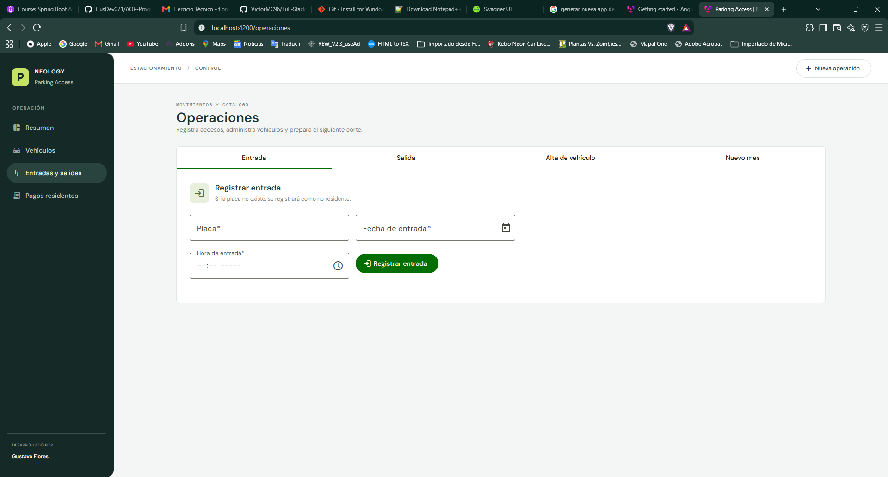 | 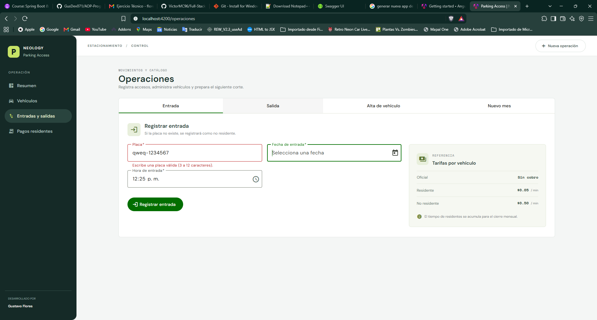 |
| 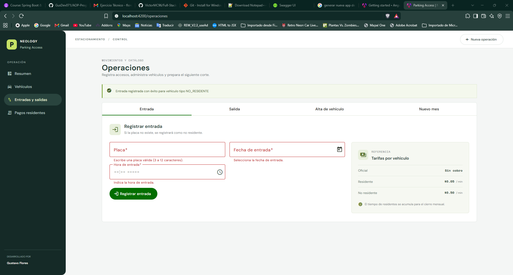 | 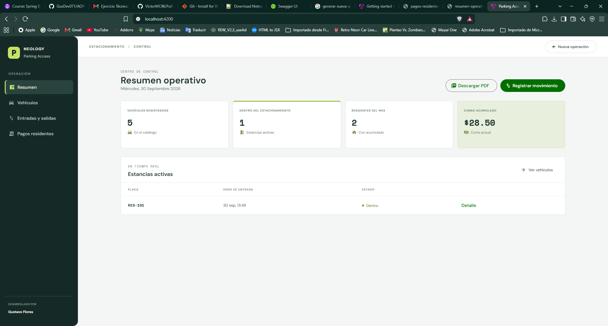 |
| 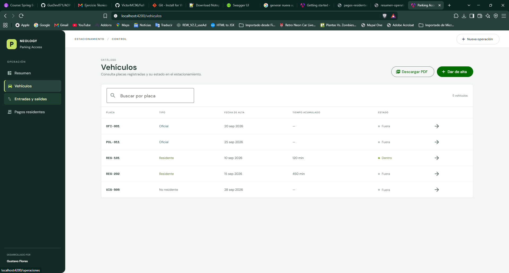 |  |
| 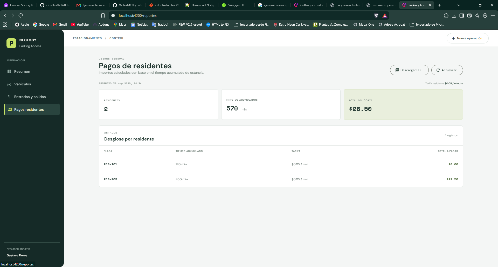 | 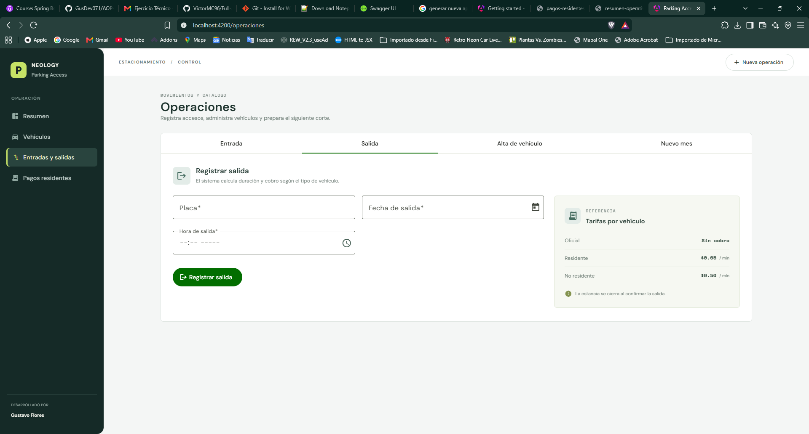 |
| 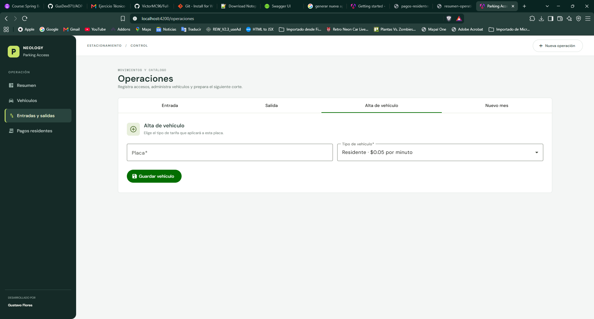 | 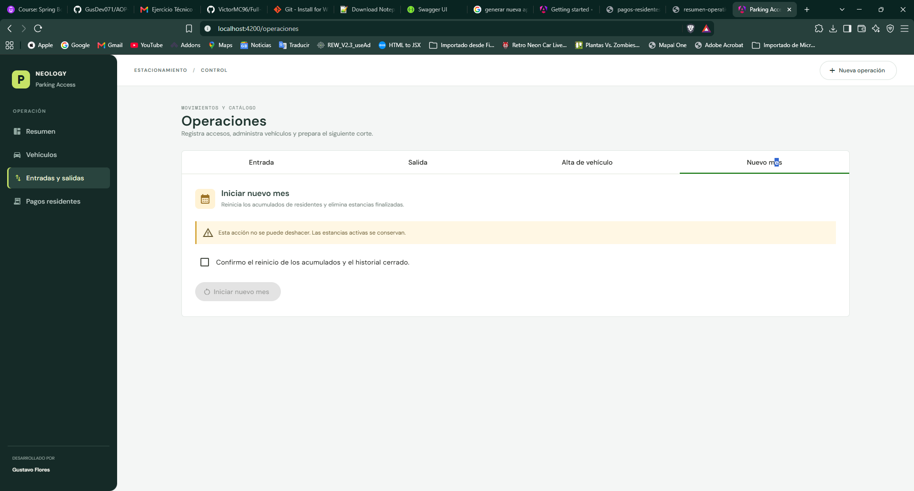 |
| 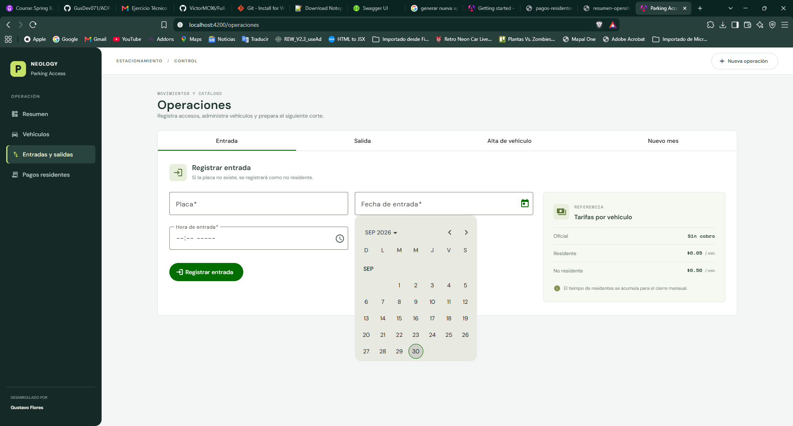 | 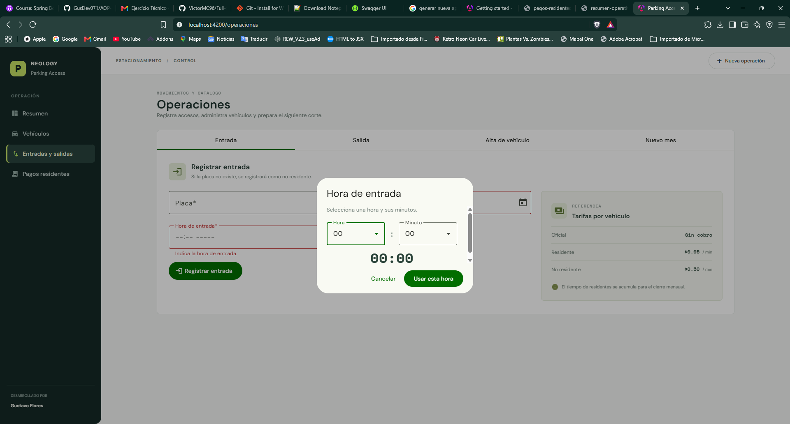 |
| 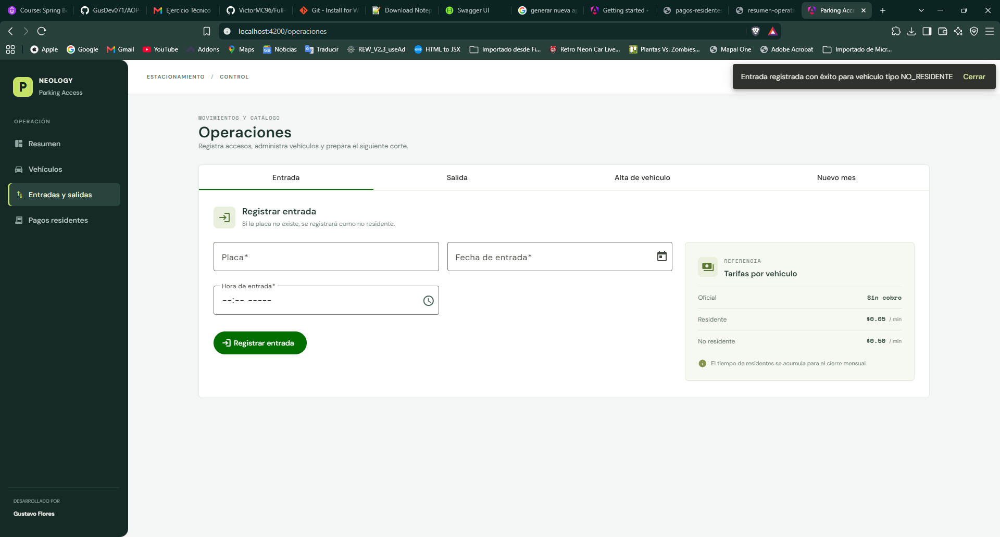 | 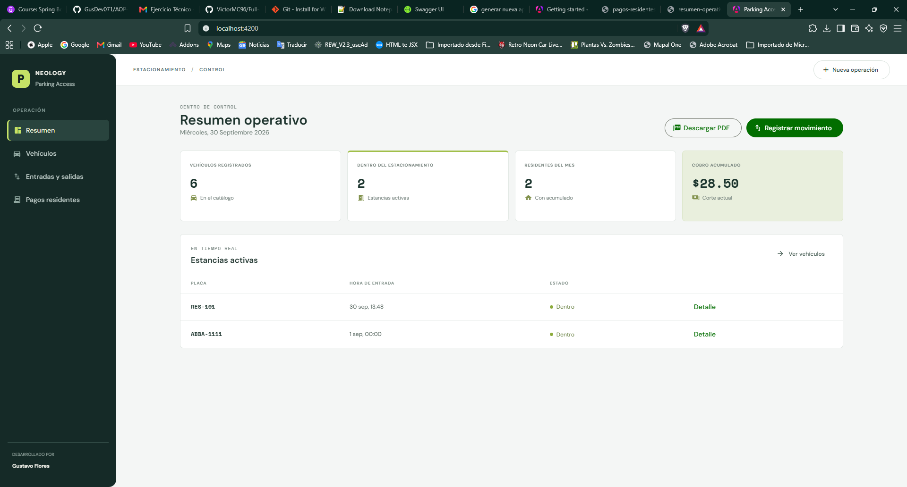 |
|  | 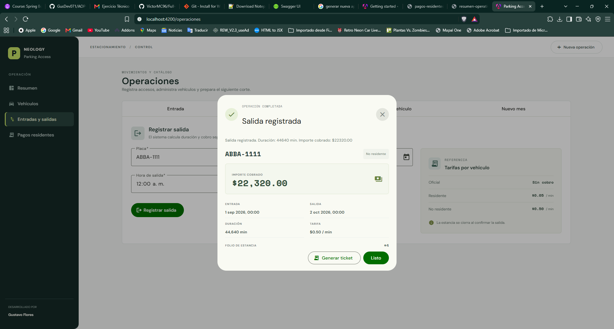 |
| 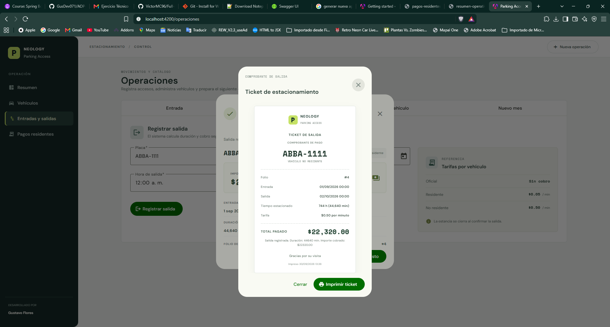 |  |
| 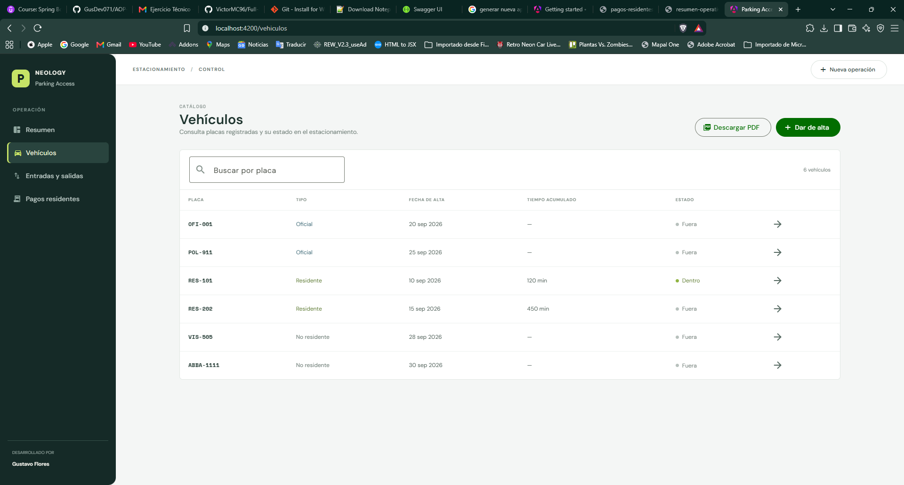 | 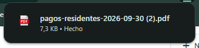 |
| 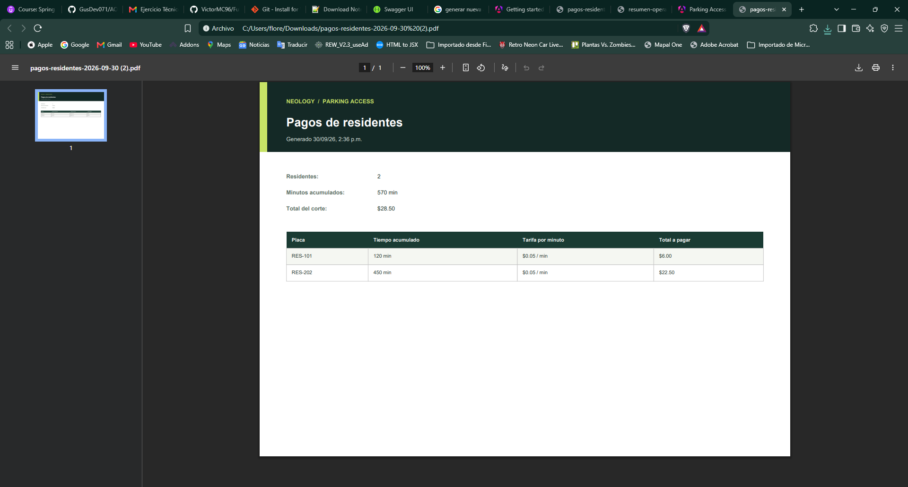 | |

---
*Desarrollado para el proceso de evaluación técnica de Neology.*

